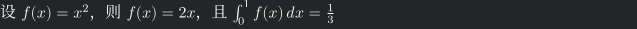

# sixeltex

把 LaTeX / 中文 / 数学表达式渲染成 **sixel 终端图形**。

一个单文件 Python 脚本，走真实的 `xelatex`——因此 **支持中文**，
也能直接渲染你手里的完整 `.tex` 文件。
输出会自动适应终端列宽，不会撞出屏幕。



---

## 安装

只需两步：确认依赖就位，把脚本放进 `$PATH`。

```bash
# 1. 检查依赖（缺哪个装哪个）
command -v xelatex gs pdftocairo magick

# 2. 安装
install -m 755 sixeltex ~/.local/bin/sixeltex

# 3. 验证
sixeltex '\frac{1}{1+x}'
```

`~/.local/bin` 通常已在 `$PATH` 里。如果没有，改成 `sudo install -m 755 sixeltex /usr/local/bin/`。

Python 仅需标准库（3.9+ 即可），不需要 pip 安装任何包。

---

## 它能做什么

与已有工具的区别：

与 sixelmath 的关键区别：

| | sixelmath | sixeltex |
|---|---|---|
| 渲染引擎 | 纯 Python ziamath | 真实 xelatex |
| 中文 | **不支持** | 支持（ctex + fontspec） |
| 输入 | 只吃裸数学表达式 | 表达式 **或** 完整 .tex 文件 |
| 定界符 | 自己拼 | 自动判定，`\$...\$` 可直接用 |
| 背景 | 固定深色 | 自动探测终端背景色并合成 |
| 环境 | 写死在代码 | 单一参数化模板表 |

---

## 快速开始

```bash
# 单个公式
sixeltex '\frac{1}{1+x}'

# 带 $ 也照样能用（会自动剥掉）
sixeltex '\$E = mc^2\$'

# 标准输入
echo 'x^2 + y^2 = z^2' | sixeltex

# 中文 + 数学混排
sixeltex '设 \$f(x)=x^2\$，则 \$f''(x)=2x\$'

# 完整 .tex 文件（自动识别，原样编译）
sixeltex ~/文档/论文.tex
```

---

## 输入模式：自动判定

脚本看输入里有没有 `\documentclass`：

- **有** → 完整文件模式，输入原样交给 xelatex，不套模板
- **没有** → 表达式模式，输入被包进模板的 `\begin{document}...\end{document}` 之间

### 表达式模式下的自动包装策略

| 输入形态 | 处理方式 |
|---|---|
| `\frac{1}{1+x}` | 套 `\[ ... \]` 行间公式 |
| `\$E=mc^2\$` | 剥掉外层 `\$`，套 `\[ ... \]` |
| 含 `pmatrix`/`align`/`cases` 等数学环境 | 外层补 `\[ ... \]`（否则报 `Missing $ inserted`） |
| 含中文或正文文字 | 原样作正文段落，内部 `\$...\$` 交给 LaTeX 处理 |
| 多行 / 含 `\\` | 套 `align*` |

> 最后一条是实测踩出来的：中英混排内容若被强行套 `\[...\]`，内嵌的 `\$...\$`
> 会和外层定界符冲突，报 `Display math should end with \$\$`。

---

## 参数

### 字号与尺寸

| 参数 | 默认 | 说明 |
|---|---|---|
| `-s`, `--size` | 自动探测 | 文档类字号(pt)。默认用 CSI 14t/18t 探测终端字号，探测失败回退 **10pt**。LaTeX 只认 10/11/12 档位，其他值静默归到最接近档位 |
| `-S`, `--math-scale` | 不缩放 | 数学公式连续缩放倍数，如 `1.5` / `0.8`。实测 0.5/1.5/2.0 输出 39/115/153 px，线性生效 |
| `-d`, `--dpi` | 自动反算 | 光栅化 DPI。默认按 `-W` 与字号反算，使内容恰好占满列数 |
| `-W`, `--cell-width` | `8` | 终端一个字符格的像素宽，决定图占多少列 |
| `-m`, `--margin` | `0` | 四周额外留白(像素)。内容边界由 ghostscript 自动算，通常不需要手动留白 |

### 颜色

| 参数 | 默认 | 说明 |
|---|---|---|
| `-c`, `--color` | 自动探测 | 前景色，命名色或 `#RRGGBB` |
| `-b`, `--bgcolor` | 自动探测 | 背景色。默认合成用；`--transparent` 时不生效 |
| `--transparent` | 关 | 透传背景：只画字形像素，背景不写色。默认是**合成背景色** |
| `-w`, `--width` | 自动探测 | 强制指定终端列数 |
| `--no-wrap` | 关 | 关闭按列宽折行 |

**颜色解析顺序**：命令行参数 → OSC 10/11 终端探测 → 环境变量 `SIXELTEX_FG` / `SIXELTEX_BG` → 硬编码兜底 `#fcfcfc` / `#232627`。

#### 关于背景色（默认合成）

默认行为：LaTeX 不设页面背景 → pdftocairo -transp 得到带 alpha 的 PNG
→ 合成到 `-b`/探测到的终端背景色 → 输出 sixel。

这样公式能融入终端配色，不会与终端背景撞色。

如果你确实需要“背景不写色、让终端原样透出”，用 `--transparent`。
注意 sixel 协议本身没有 alpha 通道，`--transparent` 的实现是自写编码器
只编码 alpha>0 的字形像素、背景像素不写色。

#### 按终端列数自动折行（默认开启）

两件事同时做，才能保证“不超宽”：

**1. 排版层限宽并折行**

一列 = 半个中文字宽（西文占 1 列、中文占 2 列），
所以可用文本宽 = `列数 / 2` 个中文字宽：

```latex
\setbox0=\hbox{中}\SixeltexWidth=40\wd0    % 80 列
\parbox{\SixeltexWidth}{...}                    % 超宽自动折行
```

**2. DPI 反算（关键）**

Sixel 图在终端里按像素渲染，不会自动缩放到列。
所以像素宽必须等于 `列数 × 字符格宽`。反推：

$$\mathrm{DPI} = \frac{2 \times \mathrm{cell\_w} \times 72}{\mathrm{fontsize}}$$

列数被约掉了——**DPI 只取决于字符格宽和字号**。
字号 10pt、cell_w 8px 时 DPI 自动算为 115。

这正是之前“长了接近一倍”的原因：固定 DPI=200 把本应占 640px 的
80 列内容渲染成 1103px，约占 138 列。

实测（10pt, cell_w=8px）：

| 列数 | 输出像素宽 | 期望值 |
|---|---|---|
| 40 | 318px | 320px |
| 80 | 636px | 640px |
| 120 | 942px | 960px |

字符格宽默认 **8px**（多数终端 100% 缩放下的等宽字符格宽）。
你的终端不是 8px 时，用 `-W` 改。

**列数探测顺序**：`os.get_terminal_size()` → `shutil.get_terminal_size()`
→ `$COLUMNS` → 回退 80。已在伪终端里实测：设 60/120/200 列都能精确读到。

相关参数：
- `-w N`：强制指定列数
- `-W PX`：字符格像素宽（默认 8）
- `-d DPI`：显式指定 DPI（默认自动反算，显式指定则不反算）
- `--no-wrap`：关闭折行
- `--crop-width`：左右也按内容裁剪（**默认只裁上下、左右保留整页宽度**）

### 环境与模板### 环境与模板### 环境与模板### 环境与模板

| 参数 | 默认 | 说明 |
|---|---|---|
| `-t`, `--doc-class` | `ctexart` | 文档类。可选 `ctexart`/`ctexrep`/`ctexbook`/`article`/`beamer` |
| `-P`, `--packages` | — | 追加宏包，空格分隔，如 `-P tikz pgfplots` |
| `-A`, `--preamble` | — | 追加 preamble 原文，如 `-A '\usepackage{multirow}'` |
| `-e`, `--env` | 自动 | 强制指定数学环境，如 `-e 'align*'` |
| `-C`, `--cjk-font` | 自动探测 | 中文字体名 |
| `-L`, `--latin-font` | — | 西文字体名 |
| `-M`, `--math-font` | — | 数学字体名 |

**本机探明的可用字体**（均已实测 fontspec 可直接引用，零缺字）：

| 用途 | 字体名 |
|---|---|
| 中文 | `Noto Serif CJK SC`（默认）、`Noto Sans CJK SC`、`Sarasa Term SC Nerd Font`、`AR PL UMing CN` |
| 数学 | `Noto Sans Math`（本机唯一带 MATH 表的可用字体） |
| 西文 | `Latin Modern Roman`、`Noto Serif`、`Liberation Serif` |

> 字体名含空格必须加引号：`-C 'Noto Sans CJK SC'`

### 输出与调试

| 参数 | 说明 |
|---|---|
| `-p`, `--colors` | sixel 调色板颜色数，默认 `256` |
| `-n`, `--dry-run` | 只打印生成的 `.tex` 源，不编译。**排查参数问题首选** |
| `-k FILE`, `--keep-png` | 把中间 PNG 另存到指定路径 |
| `-K`, `--keep-dir` | 保留临时工作目录（含 `.tex`/`.pdf`/`.log`） |
| `-v`, `--verbose` | 打印模式、颜色、DPI 等诊断信息 |

---

## 环境变量

| 变量 | 用途 |
|---|---|
| `SIXELTEX_FG` | OSC 探测失败时的前景色 |
| `SIXELTEX_BG` | OSC 探测失败时的背景色 |

OSC 探测要求 stdin/stdout 都是 TTY。在管道、重定向、无终端环境下会自动走环境变量或硬编码兜底。

---

## 依赖

本机均已探明存在：

| 组件 | 用途 |
|---|---|
| `xelatex` | 编译（XeTeX，支持 fontspec/xeCJK） |
| `gs` (Ghostscript) | 算内容 bounding box、裁剪 |
| `pdftocairo` (Poppler) | PDF → 透明 PNG |
| `magick` (ImageMagick) | 合成背景色、编码 sixel |
| LaTeX 宏包 | `ctex`, `amsmath`, `amssymb`, `xcolor`, `unicode-math`, `graphicx`, `geometry` |

启动时会逐一 `shutil.which` 确认，任一缺失立即报错退出，不静默兜底。

---

## 典型用法示例

```bash
# 深色终端下默认就好看
sixeltex '\int_0^\infty e^{-x^2}\,dx = \frac{\sqrt{\pi}}{2}'

# 浅色终端：白底黑字
sixeltex -c '#000000' -b '#ffffff' 'x^2'

# 公式放大 1.5 倍
sixeltex -S 1.5 '\sum_{n=1}^{\infty}\frac{1}{n^2}'

# 矩阵
sixeltex '\begin{pmatrix} a & b \\ c & d \end{pmatrix}'

# 用 tikz 画图（需 -P 加载宏包）
sixeltex -P tikz '\begin{tikzpicture}\draw (0,0)--(1,1);\end{tikzpicture}'

# 中文报告
sixeltex -t ctexrep -C 'Noto Serif CJK SC' 报告.tex

# 先看生成的 LaTeX 源，确认无误再渲染
sixeltex -n -S 2.0 '\frac{1}{1+x}'

# 保存 PNG 备用
sixeltex -k ~/图片/公式.png '\alpha + \beta = \gamma'
```

---

## 排障

| 现象 | 原因与处理 |
|---|---|
| `缺少依赖: xxx` | 装对应组件后重试 |
| `xelatex 编译失败` + 日志尾部 | 看 `-K` 保留目录里的 `xelatex.log`；LaTeX 语法错误会带 `!` 行号和 `l.NN` 出错行 |
| `警告：检测到 N 个缺字` | 字体不含所需字形，换 `-C` / `-M` / `-L` |
| `无法解析前景色` | 颜色值不合法，已自动回落默认值 |
| `字号 Npt 不是 LaTeX 标准档位` | 已归到最接近的 10/11/12pt；要连续缩放用 `-S` |
| `-C` 报 `unrecognized arguments` | 字体名没加引号，被 shell 拆成多个词 |
| 输出尺寸不符合预期 | 用 `-n` 看生成的 `.tex`，用 `-k` 看中间 PNG |
| OSC 颜色探测没生效 | 非 TTY 环境下不会探测，用 `SIXELTEX_FG`/`SIXELTEX_BG` 或 `-c`/`-b` 显式指定 |

---

## 实现要点

### 渲染管线

```
输入 → 模式判定 → 模板组装 → xelatex 编译 → PDF
  → gs 算 bbox 写 CropBox → 裁剪
  → pdftocairo -transp → 透明 PNG
  → magick 合成背景色
  → magick sixel:- → stdout
```

### 两个关键实现细节

**1. 内容裁剪为何不用 preview 包**

`preview` 包配 `ctexart` 时只裁到第一个公式，多行/混排内容会整段丢失
（实测 `No pages of output` 或只得到第一个 `\$E=mc^2\$`）。
改用 `pdftotext -bbox` 的**字符级边界**与 ghostscript 的矢量边界**取并集**，
再写进 CropBox。只裁上下、左右保留整页宽度。

为什么不能只用 gs：gs 的 bbox 设备会漏掉上下标与积分号伸出的部分
（实测：含 `\$x_1\$` `\$x^2\$` 的文本，gs 给 11.9pt 高，字符实际边界是 14.3pt）。

**2. 颜色为何不能直接写进 `\color{}`**

`\color{#fcfcfc}` 里的 `#` 在 LaTeX 里是宏参数标记，会报
`Illegal parameter number in definition of \XC@@tmp`。
必须先 `\definecolor{sixeltexfg}{HTML}{FCFCFC}` 再 `\color{sixeltexfg}`。

---

## 依赖

| 组件 | 用途 |
|---|---|
| `xelatex` | LaTeX 编译（XeTeX，支持 fontspec / xeCJK） |
| `gs`（Ghostscript） | 计算矢量内容边界、写 CropBox |
| `pdftocairo`（Poppler） | PDF → 透明 PNG |
| `pdftotext`（Poppler） | 提取字符级边界 |
| `pdfinfo`（Poppler） | 读取页面尺寸 |
| `magick`（ImageMagick） | 合成背景色、sixel 编码 |

LaTeX 宏包：`ctex` `amsmath` `amssymb` `xcolor` `unicode-math` `graphicx` `geometry`。

Debian/Ubuntu 下大致是：

```bash
sudo apt install texlive-xetex texlive-lang-chinese texlive-science \
                 poppler-utils ghostscript imagemagick
```

## 自包含性

**Python 侧完全自包含**：仅用标准库（`argparse` `os` `re` `shutil`
`subprocess` `sys` `tempfile`），不依赖任何 pip 包。

**但它不是零依赖工具**：必须有 `xelatex`、Ghostscript、Poppler（`pdftocairo`
`pdftotext` `pdfinfo`）、ImageMagick，以及带 `ctex` 的 TeX Live。
这些在启动时会逐项 `shutil.which` 确认，缺哪个就报哪个，不会抛
Python traceback。

**字体**：默认用 `fc-list` 探本机实际存在的中文字体（Noto CJK 优先），
都找不到时会提示用 `-C` 指定。字体不属于静态依赖——不同机器可用集合不同。

**未打包**：没有 `pyproject.toml` / `requirements.txt`，也没有测试。
它是一个**单文件脚本**，而不是可装配的 Python 包。

## 已知限制

- **终端需支持 sixel**。可用性见 [arewesixelyet.com](https://www.arewesixelyet.com)。
- **字符格宽默认 8px**。你的终端缩放不是 100% 时，用 `-W` 调整（见上文）。
- **字号探测依赖 `CSI 14t`/`CSI 18t`**。终端不响应时回退 10pt，也可用 `-s` 手动指定。
- **Sixel 无 alpha 通道**。默认把结果合成到探测到的终端背景色上；`--transparent` 可改为只画字形像素。

## 排查

| 现象 | 处理 |
|---|---|
| 输出偏宽/偏窄 | 调整 `-W`（字符格像素宽），或 `-v` 查看探测到的列数 |
| 中文显示为方块 | 换 `-C` 指定本机存在的中文字体 |
| 编译失败 | `-K` 保留工作目录，查看 `xelatex.log` |
| 输出一片空白 | 确认终端支持 sixel；`-k out.png` 导出 PNG 验证内容本身是否正常 |

## 许可证

**本项目当前未声明开源许可证。**

这意味着默认适用著作权法——他人**没有**明确的权利来使用、修改或分发本代码。
如果你打算让他人使用，建议在仓库根目录添加一份许可证文件。常见选择：

- [MIT](https://choosealicense.com/licenses/mit/)：最简约，广泛用于单文件工具
- [Apache-2.0](https://choosealicense.com/licenses/apache-2.0/)：含明确专利授权

选定后把许可证全文存为 `LICENSE`，并把本节替换为一句 `MIT License` 之类的声明即可。
